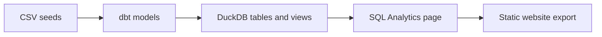

# Rosetta Studio Analytics Demo

**From dbt models to AI-powered Analytics.**

This project uses fictional Jaffle Shop data, DuckDB, and dbt to demonstrate Analytics pages in **Rosetta DBT Studio**. Explore the finished report, see how Markdown and SQL power its components, and export a browser-ready website alongside the dbt project.

[Download Rosetta DBT Studio](https://rosettadb.io/download-dbtstudio.html) · [Star Studio on GitHub](https://github.com/rosettadb/dbt-studio) · [Demo repository](https://github.com/Nuri1977/rosetta-studio-analytics-demo)

## Explore the finished report

Clone the repository:

```sh
git clone https://github.com/Nuri1977/rosetta-studio-analytics-demo.git
cd rosetta-studio-analytics-demo
```

Open **[analytics-page/index.html](analytics-page/index.html)** from your local checkout in a browser. GitHub displays HTML source; download or clone the project to view the rendered report.

The report includes:

- Revenue, order count, and average order value cards.
- Daily revenue and orders-by-status charts.
- A payment-method breakdown and recent-orders table.

The exported site includes query results captured at build time, so viewing it does not require a running database or Studio. Keep the entire `analytics-page/` folder together when sharing it. To refresh its data, rebuild the site in Studio.

The root-level `index.html`, `pages/`, and `assets/` contain another export. **`analytics-page/` is the report used for this demo.**

## How it works



In Studio, an Analytics page combines Markdown, named SQL queries, and components such as `BigValue`, `LineChart`, `BarChart`, `DonutChart`, and `DataTable`. You can author the page manually or use the AI assistant to help write and refine it. The preview renders the components; running a query or the whole page supplies their data.

The editable page is saved in Studio for its connection. The files in `analytics-page/` are the generated website. Cloning this repository gives you the dbt project and the export; it does not automatically register an editable Analytics page in Studio.

## Build the local DuckDB database

### 1. Install the project dependencies

The project targets **Python 3.13**, as recorded in `.python-version`. With [uv installed](https://docs.astral.sh/uv/getting-started/installation/), run from the repository root:

```sh
uv sync --locked
```

This uses the committed `uv.lock` to install the project's dbt Core, dbt-duckdb, and supporting packages.

### 2. Set your database path

The committed [profiles.yml](profiles.yml) contains the author's absolute local path. Before running dbt on another machine, update it to your own database location. For commands run from the repository root, use:

```yaml
rosetta_studio_analytics_demo:
  target: dev
  outputs:
    dev:
      type: duckdb
      path: jaffle_shop.duckdb
      schema: main
      threads: 4
```

Keep the profile name `rosetta_studio_analytics_demo`; it matches [dbt_project.yml](dbt_project.yml). Use the full local database path when configuring Studio's DuckDB connection.

### 3. Load, transform, and test

```sh
uv run dbt debug --profiles-dir .
uv run dbt build --profiles-dir .
```

[`dbt build`](https://docs.getdbt.com/reference/commands/build) loads seeds, runs models, and executes their tests in dependency order. The DuckDB adapter creates `jaffle_shop.duckdb` at the configured path; there is no separate database-creation command to run first. Review the build results and the demo limitations below.

To run the stages separately:

```sh
uv run dbt seed --profiles-dir .
uv run dbt run --profiles-dir .
uv run dbt test --profiles-dir .
```

The database file and dbt build artifacts are excluded from Git. Generate them locally from the included seeds and models.

## Create an Analytics page in Rosetta DBT Studio

1. Install [Rosetta DBT Studio](https://rosettadb.io/download-dbtstudio.html) and open the cloned dbt project.
2. Build the database as described above, then connect Studio to your local `jaffle_shop.duckdb` file.
3. Open the SQL Editor's **Analytics** tab and create a page for that connection.
4. Write Markdown, named SQL blocks, and component tags, or ask the Analytics assistant to help generate them.
5. Run the queries, inspect their results, and check the rendered preview.
6. Choose **Build Analytics Site** and select an output folder inside the dbt project, such as `analytics-page/`. Building into that folder updates the existing export.
7. Open the exported `index.html` in a browser and review the result.

For a minimal page, paste this into the Analytics editor and run it:

````markdown
# Jaffle Shop Orders

```sql total_orders
SELECT count(*) AS order_count
FROM fct_orders
```

<BigValue data={total_orders} value="order_count" label="Total Orders" />
````

The full demo uses `fct_orders` for order measures and trends, and `stg_payments` for the payment-method breakdown. The exported [report HTML](analytics-page/pages/jaffle-shop-report.html) also contains its Markdown source and captured query results.

The AI assistant can use the active page and selected database context. Linked dbt project files, imported skills, connected MCP servers, and Agent Memory can extend that context when configured and enabled. Review generated SQL and results before exporting.

## Project contents

| Path | Purpose |
| --- | --- |
| [seeds/](seeds/) | Eight CSV datasets: customers, orders, payments, products, order items, customer addresses, order-status history, and returns. |
| [models/staging/](models/staging/) | Staging models and intermediate joins. |
| [models/marts/](models/marts/) | Customer and product dimensions, the order fact model, monthly revenue, and customer lifetime value. |
| [models/orders.sql](models/orders.sql), [models/customers.sql](models/customers.sql) | Original Jaffle Shop order and customer models. |
| [analytics-page/](analytics-page/) | The demo's exported HTML report, styles, and rendering runtime. |
| [dbt_project.yml](dbt_project.yml), [profiles.yml](profiles.yml) | dbt project and DuckDB connection configuration. |
| [pyproject.toml](pyproject.toml), [uv.lock](uv.lock), [requirements.txt](requirements.txt) | Python dependencies and pinned installation files. |
| [data_enginering_course.md](data_enginering_course.md) | Course outline for the wider data-engineering exercise. |

The current project contains **15 SQL models** and **8 seed files**, including 100 customers and 99 orders. The data is fictional and intended for learning and demonstration.

## Generate dbt documentation

```sh
uv run dbt docs generate --profiles-dir .
uv run dbt docs serve --profiles-dir .
```

This produces dbt's model documentation and lineage site. The Analytics website is generated separately through Studio's **Build Analytics Site** action.

## Demo limitations

- **Revenue calculations:** `fct_orders` joins payments and order items before aggregation. Multiple matching rows can duplicate payment amounts and item counts. Revenue and average-order-value cards in the export are demo output; aggregate each child table to order level before using these measures for business reporting.
- **Address history:** `int_orders_joined` joins all customer addresses. Customers with multiple address records can produce duplicate order IDs and fail the existing uniqueness test.
- **Incremental updates:** `fct_orders` selects dates later than the current maximum date. Updates to existing orders and late-arriving records need additional handling.
- **Project configuration:** `dbt_project.yml` still has a `models.jaffle_shop` configuration block, while the project is named `rosetta_studio_analytics_demo`. This can produce an unused-configuration warning; that block does not configure the renamed project's models.

## DuckDB file locks

If dbt or Studio reports `Could not set lock on file`, close the other connection holding that database file before retrying. In an open DuckDB CLI session, use:

```text
.exit
```

When switching between Studio and terminal dbt commands, release the active database connection first. See [DuckDB's concurrency documentation](https://duckdb.org/docs/stable/connect/concurrency) for details.

## Credits and license

Based on [dbt Labs' Jaffle Shop DuckDB project](https://github.com/dbt-labs/jaffle_shop_duckdb), extended with teaching datasets, additional models, and a Rosetta DBT Studio Analytics export.

See [LICENSE](LICENSE) for the repository's Apache 2.0 license. Rosetta DBT Studio is a separate project with its own [source and license](https://github.com/rosettadb/dbt-studio).
